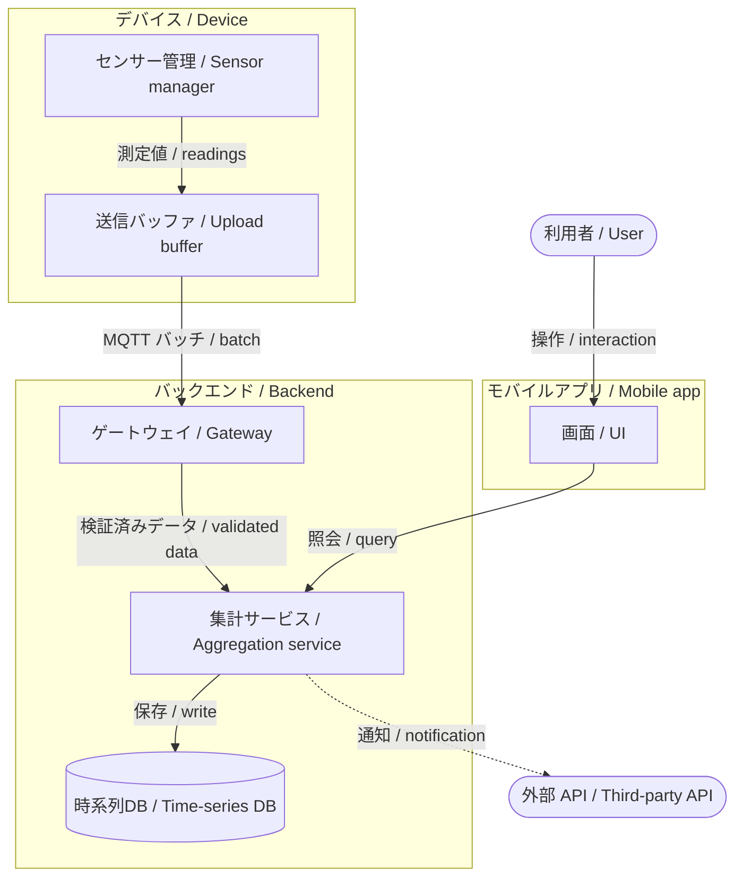
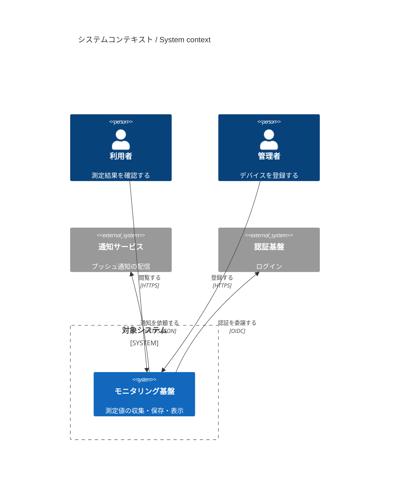
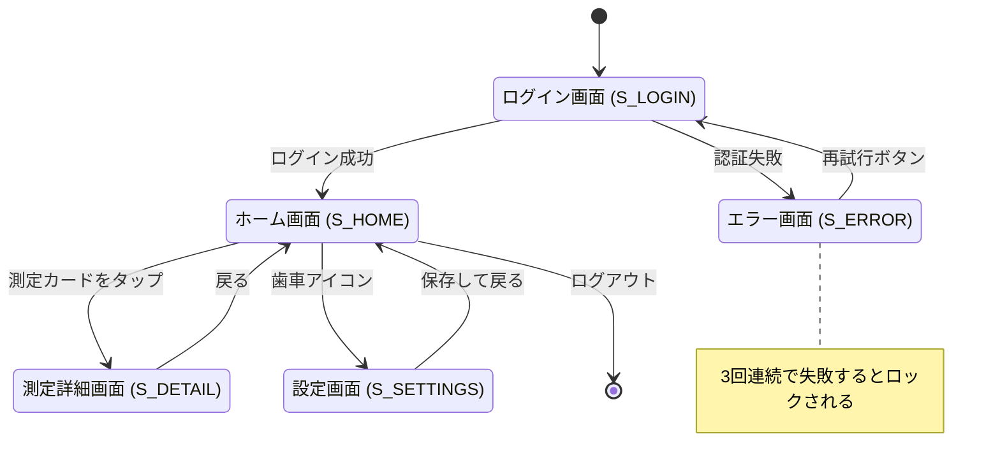
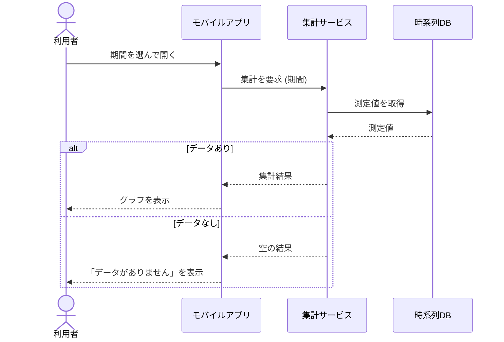

# Mermaid templates for spec-loop

Starting points for the generation agents and the coordinator (REQ-SL-010). Copy the shape, replace
the content. Every block here is checked with `mmdc` by the repository tests, so a template that
no longer renders is a bug in this file.

Rules that apply to every diagram:

- The first line is the diagram type (`flowchart TD`, `C4Context`, `stateDiagram-v2`,
  `sequenceDiagram`); no text before it, no frontmatter.
- Node ids are ASCII (`GW`, `S_LOGIN`); human text goes into the label. Never use `end` as an id.
- Quote every label that contains spaces, punctuation or non-ASCII: `GW["ゲートウェイ (MQTT)"]`.
  Japanese labels work as is; the PDF pipeline switches `htmlLabels` off itself, so do not put
  `%%{init}%%` directives or HTML (`<br/>`) in the diagram.
- Keep one diagram under about 15 nodes. Split by subsystem instead of cramming; a second diagram
  per subsystem is better than an unreadable first one.
- Name components exactly as in the architecture diagram wherever they reappear (Phase 3
  `sequenceDiagram` participants, Phase 2 notes).
- Trace comments: `%% BS-SCOPE-001` after a node is allowed and helps the review; the tables next
  to the diagram remain the source of the traceability.

## Phase 1 - flowchart TD (default: structure + data flow)

Conventions: `subgraph` = subsystem or trust boundary; `([...])` stadium = external actor or system;
`[(...)]` cylinder = data store; `[...]` rectangle = internal component; labelled edge = data
flowing in the arrow's direction; dashed edge `-.->` = asynchronous or optional flow.



## Phase 1 - C4Context (people and external systems dominate)

Use when most of the story is "who talks to which external system". Add a `flowchart TD` (above)
for the internals. Keep to `Person`, `System`, `System_Ext`, `System_Boundary`, `Rel`; fancier
C4 elements render inconsistently across mmdc versions.



## Phase 2 - stateDiagram-v2 (screen transitions)

Screens are states, user actions label the edges. Declare each state with an ASCII id and a
quoted description so the label shows the screen name. Include `[*]` start and end, and the error
and empty states the mocks show. Use a `note` for a guard condition that does not fit an edge label.



## Phase 3 - sequenceDiagram (reference for the use-case analyst)

Participants are the architecture components, with the same names. One diagram per use case that
crosses several components; label messages with the data, use `alt` / `opt` for the alternative
scenarios.



## Validation

```bash
mmdc -i diagram.mmd -o diagram.svg      # binary from HANDOFF_MMDC_BIN when set
```

Write the temp files outside the project tree. Non-zero exit = syntax error: fix and re-run before
the diagram is shown to the user. Without `mmdc` the diagram is `unverified` and the specification
says "diagrams not validated".
